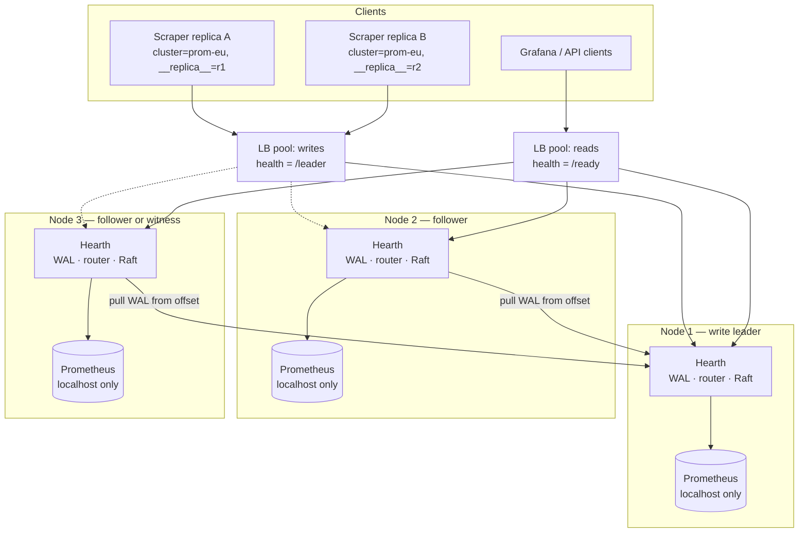
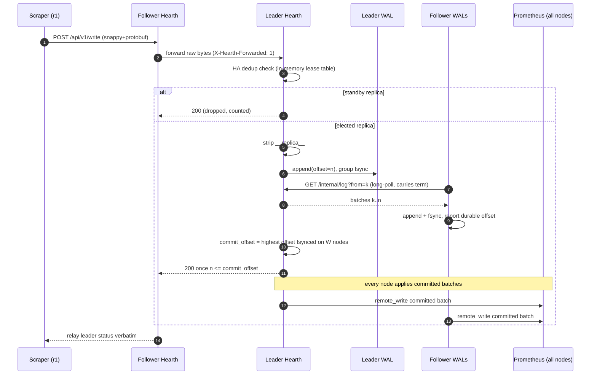
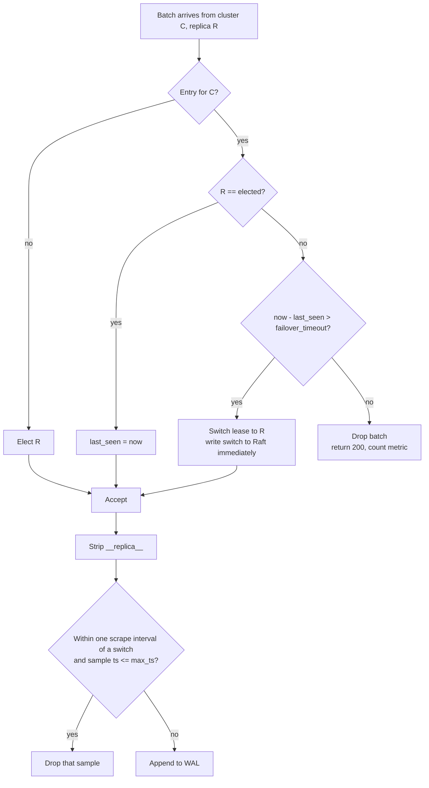
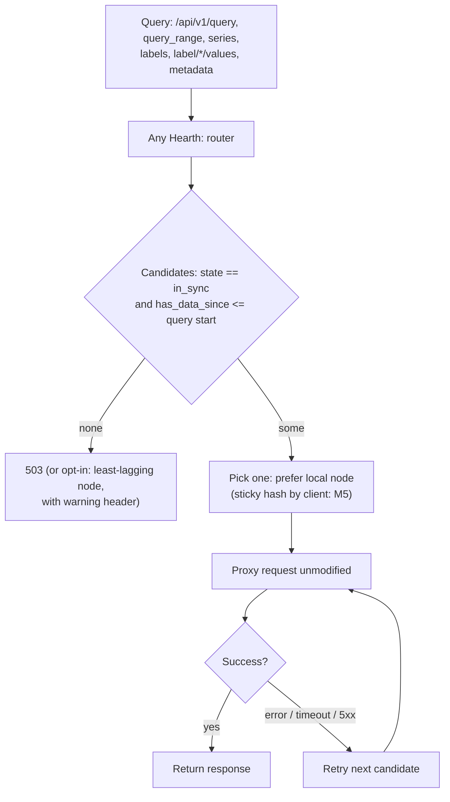
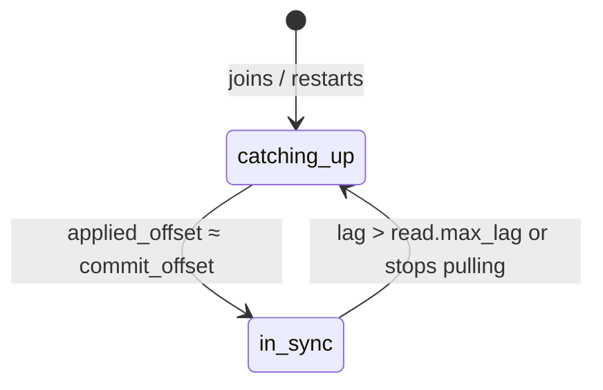
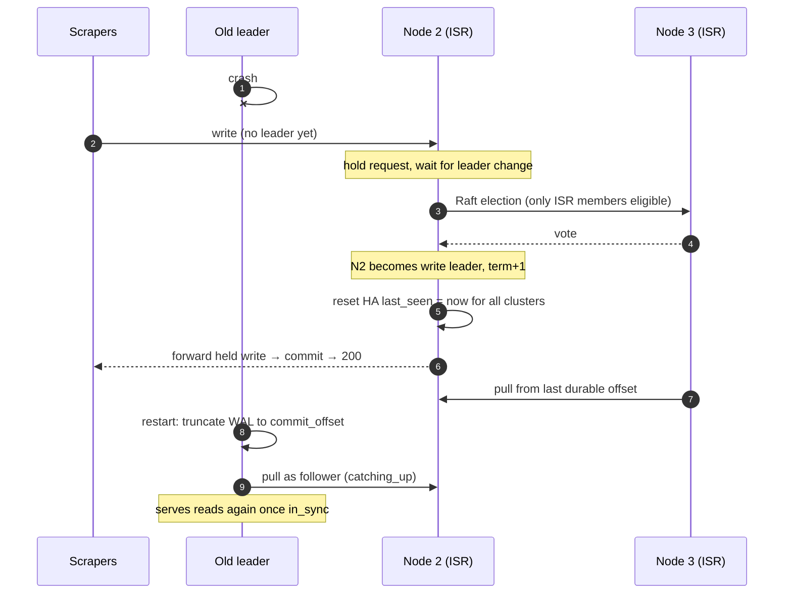
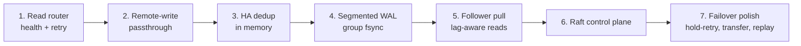

# Hearth — Design

Hearth is a **single-binary HA coordinator for Prometheus**. It sits in front of a
cluster of standalone Prometheus nodes that act purely as storage + PromQL engines.

- **Write path:** accepts `remote_write` from redundant scraper pairs, deduplicates
  them via a per-cluster replica lease, appends to a replicated log (WAL), and applies
  committed batches to every Prometheus node.
- **Read path:** routes each query, unmodified, to exactly one Prometheus node that is
  fully caught up — giving native PromQL results with no merge heuristics.
- **Coordination:** an embedded Raft group stores small control-plane state only
  (write leader, in-sync set, replica table, node states). Samples never go through Raft.

Every design decision should be explainable by a failure it prevents. Record those
decisions in [log.md](log.md).

---

## 1. Topology

Each node = one Hearth coordinator + one Prometheus bound to `localhost`.
Clients only ever talk to coordinators.



- Raft needs an odd number of voters (3 or 5). With only two Prometheus nodes, run a
  third Hearth in **witness mode** (`--role=witness`): Raft voter, no Prometheus, no data.
- Backends must run with the remote-write receiver enabled and an
  **out-of-order time window ≥ WAL retention**, so catch-up replays are accepted.

---

## 2. Write path

One write leader (the Raft leader) owns a single totally ordered log.
Every node accepts writes at the edge; non-leaders forward.



### Offsets per node

| Offset | Meaning | Drives |
|---|---|---|
| `durable_offset` | fsynced into local WAL | commit / acks |
| `applied_offset` | written into local Prometheus | read routing |
| `commit_offset` (cluster) | fsynced on ≥ `W` nodes | ack + apply |

### WAL

- Segmented, append-only files (e.g. 64–128 MiB), records = `{offset, term, crc, len, payload}`.
- **Group commit:** batch fsync every 10–50 ms; all writers waiting on that window are
  released together.
- On startup: scan the last segment, truncate any torn/CRC-failing tail.
- Delete a segment only when every follower's confirmed offset is past it, or when it
  exceeds `wal.max_age` / `wal.max_bytes`. A follower that falls behind the cap is marked
  `has_data_since=T` in Raft.

### Forwarding rules (followers)

- Forward the **raw, still-compressed body** + `Content-Type`, `Content-Encoding`,
  `X-Prometheus-Remote-Write-Version`, auth/tenant headers.
- Wait synchronously; relay the leader's status code verbatim.
- **No leader (election):** hold the request, wait for the leader-change notification,
  then forward. Return `503` + `Retry-After: 1` only after `forward.hold_timeout`
  (default 10–15 s, must stay below the scraper's 30 s remote-write timeout).
- Max one hop: a node receiving `X-Hearth-Forwarded: 1` that is not leader returns `503`.
- Cap concurrent forwards per node; return `429` above the cap.

---

## 3. HA replica dedup (lease logic)

Each scraper pair shares a `cluster` label and differs in `__replica__`
(or an `X-Replica` header, if configured). The label is a **routing tag, never stored**.

State per cluster (in leader memory, mirrored to Raft):
`elected_replica`, `last_seen` (receive time), `elected_at`, `max_ts`.



Rules:

- Use **receive time** for `last_seen`, not sample timestamps.
- Standby batches get **2xx**, never 5xx/429 (otherwise the standby's own WAL backs up).
- No `cluster` label → pass through without dedup. `cluster` without replica → accept.
- Persist the table to Raft immediately on a switch, otherwise batched every
  `ha.sync_interval` (default 10 s).
- **On becoming write leader, reset every `last_seen` to now** (the inherited values are
  stale by up to `sync_interval` + election time).
- Enforce `ha.failover_timeout > ha.sync_interval + election_timeout` at startup.
- Optional: keep a ring buffer of standby batches for `failover_timeout`; on switch,
  replay samples with `ts > max_ts` to close the gap.
- Recommend stable replica names (StatefulSet pod names).

---

## 4. Read path



Reads always go through the owning node's Hearth, because each Prometheus listens on
localhost only (§1). A router never talks to another node's Prometheus directly.

```
Grafana → Hearth 1 → Hearth 3 → P3     (remote node)
Grafana → Hearth 1 → P1                (local node, no extra hop)
```

A node is a read candidate only if all of these hold. Each one is answered by a
different party:

| Question | Who answers | Shared? |
|---|---|---|
| Is P3 ready? | Hearth 3 only: polls local `/-/ready`, reports it via its own `/ready` | Same answer for everyone |
| Can I reach Hearth 3? | Each router, by polling Hearth 3's `/ready` | No: per router, views may differ |
| Does P3 have all the data? | Write leader, from `applied_offset` vs `commit_offset` (M5+) | Yes, via Raft |

Health check defaults (all tunable): interval 10s, timeout 1s, down after 3
consecutive failures, up after 1 success.

Retry timing (one clock per query). Values are defaults; all three settings are tunable.

| Setting | Default | Why this default | Tune when |
|---|---|---|---|
| Total deadline | 29s | Grafana `dataproxy.timeout` default 30s minus a 1s margin for sending the result back. | The client's timeout differs. Must stay below it. |
| Connect timeout | 2s | Survives one lost SYN (first resend at 1s, RFC 6298). Same as etcd's peer dial timeout. | Nodes are farther apart (cross-zone/region). |
| Max attempts | 3 | Each node at most once, so never more than the number of ready nodes. Worst case 3 × 2s of failed connects. Not tied to node count. | Cluster size or load differs. |
| Response timeout | (not a setting) | Each attempt gets whatever is left of the deadline. Slow failures are not retried, so nothing needs saving for a later attempt. | n/a |

Startup checks: `connect timeout < deadline` and `max attempts × connect timeout`
≤ half the deadline. Hearth **refuses to start** if any check fails.

Response buffering: the routing Hearth buffers the full response before sending
anything, so a failure mid-response can still be retried. Limit **8 MiB** (rough
default, to be tuned from measured response sizes). Above it, switch to streaming and
stop retrying that query.

Request limits and Hearth-generated errors:

- **Max query body: 10 MiB, a constant (not configurable).** It matches the limit
  Prometheus actually applies, which today is Go's `net/http` form default
  (`parsePostForm`). Hearth reads the body as raw bytes, so Go's default does not apply
  to Hearth itself. Over the limit → `413`. `test/contract` checks the Prometheus side
  and fails if a Prometheus/Go upgrade changes it.
- **`X-Hearth-Error: <reason>`** marks any error response produced by Hearth itself rather
  than relayed from Prometheus (e.g. local Prometheus not ready, body too large). No
  header = Prometheus's own answer. The routing Hearth uses it to decide whether a retry
  can help, and it is passed through to the client to help with debugging.

  | Where | What happened | `X-Hearth-Error` | Status | Routing Hearth retries? |
  |---|---|---|---|---|
  | Serving Hearth | Local Prometheus not ready | `not_ready` | 503 | Yes |
  | Serving Hearth | Local Prometheus unreachable | `backend_unreachable` | 502 | Yes |
  | Routing Hearth | Body over 10 MiB | `body_too_large` | 413 | No |
  | Routing Hearth | No ready node | `no_candidates` | 503 | No (gives up) |
  | Routing Hearth | All attempts failed (max 3) | `retries_exhausted` | 502 | No (gives up) |
  | Routing Hearth | Total deadline ran out | `deadline_exceeded` | 504 | No (gives up) |
  | Routing Hearth | Client disconnected | — (no response) | logged as 499 | No |

  Retry decisions use the reason code; the status is for humans debugging.
  Error body: Prometheus's JSON error format,
  `{"status":"error","errorType":"<type>","error":"<message>"}`, so Grafana shows the
  message to the user. `errorType` uses Prometheus's own values (e.g. `unavailable`,
  `timeout`, `bad_data`, `internal`; see `web/api/v1/api.go`).

Node data state (decided by the write leader, shared via Raft so all routers agree; M5+):



- `in_sync` is decided by **replication lag**, not just `/-/ready`. A reachable node
  with a gap must not serve reads.
- Reachability is **not** part of this shared state. It stays local to each router
  (see the table above; §5 keeps raw health-check results out of Raft).
- Optional: hedged requests to a second in-sync node after `read.hedge_after`.

---

## 5. What lives in Raft

| Key | Written when |
|---|---|
| Membership: node id, HTTP addr, Raft addr, role | join / leave |
| Write leader + term | implicit (Raft leadership); term = fencing token |
| `commit_offset` checkpoint | ~every 1 s |
| In-sync replica set (ISR) | a node falls behind / catches up |
| Node data state: `in_sync` / `catching_up` / `down`, `has_data_since` | on change |
| HA replica table | on switch; batched every `ha.sync_interval` |
| Runtime config (`W`, timeouts, retention caps) | on admin change |

**Not in Raft:** sample batches, live per-follower offsets (they ride on pull requests),
per-batch dedup decisions, raw health-check results, Prometheus data.
Snapshots are a single serialized blob (KB–MB).

Library: `github.com/hashicorp/raft` + `raft-boltdb`. Writing our own Raft is a
separate, later learning project.

---

## 6. Failover



- Only ISR members may become leader → the new leader holds every acknowledged batch.
- Uncommitted tail on the old leader was never acked → scrapers resend it; safe to truncate.
- A partitioned stale leader cannot reach `W` (pull requests carry the newer term), so its
  writes time out and scrapers retry against the real leader.
- **Graceful shutdown:** call `LeadershipTransfer()` to an in-sync follower before exiting.

---

## 7. Repository layout (target)

```
cmd/hearth/            main, flag parsing, role selection (node | witness)
proto/                 vendored remote-write v1/v2 .proto files (spec only)
internal/gen/          generated protobuf code (do not edit)
internal/remotewrite/  decode/encode, snappy, label helpers
internal/ha/           replica lease table + dedup decisions
internal/wal/          segmented log, group fsync, recovery, retention
internal/replication/  follower pull loop, commit tracking, ISR
internal/apply/        committed-batch applier → local Prometheus
internal/raftfsm/      Raft FSM, snapshot, state schema
internal/forward/      follower → leader forwarding, hold-and-retry
internal/router/       read routing, health, node state, retries/hedging
internal/server/       HTTP wiring, /leader, /ready, /metrics
test/cluster/          local test bed: plain Prometheus binaries + Hearth nodes
test/chaos/            kill / pause / netem scripts (run on a Linux VM fleet)
test/checker/          cross-node consistency checker
docs/design.md         this file
docs/log.md            decision log ("failure that forced it")
flake.nix              dev shell, build, test and cluster commands
```

Language: **Go** (static binary, cheap goroutines per follower).
Tooling: **Nix flakes** (no Makefile, no Docker). Prometheus comes from nixpkgs or a
plain release binary.
Allowed deps: protobuf runtime, `klauspost/compress` (snappy), `hashicorp/raft`,
`raft-boltdb`, `client_golang` (own metrics only). Ask before adding others.

---

## 8. Milestones

Build in order; each one must be runnable and tested before the next.



---

## 9. Testing

- **Unit:** pure logic (dedup decisions, commit computation, WAL recovery) with
  table-driven tests and an injectable clock. No real sleeps in unit tests.
- **Router (M1):** fake backends via `httptest`, one test per row of the error table
  in §4, plus the success path and a backend dying mid-response. Timeouts use short
  real values (~100–200ms); `testing/synctest` is an option later if tests get slow or
  flaky. No real Prometheus needed.
- **Contract:** `test/contract` runs a real Prometheus (skips if not on PATH) to check
  assumptions Hearth depends on, e.g. the 10 MiB body limit.
- **WAL crash tests:** kill mid-write (`kill -9`), restart, assert no acked offset is lost
  and torn tails are truncated.
- **Local test bed:** Hearth nodes + plain Prometheus processes on separate ports and
  data dirs, started from the flake. No containers.
- **Chaos:** random kill, `kill -STOP`/`-CONT` (frozen process), `tc netem`
  delay/partition. Runs on a Linux VM fleet via
  [vfkit-nix](https://github.com/melonlorrd/vfkit-nix) (Apple Silicon); also the place
  to measure fsync/group-commit latency, since macOS `F_FULLFSYNC` is not representative.
- **Consistency checker:** after each chaos run, query every node for the same series
  and range; results must be identical for all `in_sync` nodes. This is the
  correctness proof.

Commands (to be created; names may change):

```
nix develop          # dev shell: go, prometheus, protoc
nix build            # build hearth
nix run .#test       # go test ./... -race
nix run .#cluster    # local test bed
nix run .#chaos      # chaos scenario + checker (Linux VM fleet)
```

---

## 10. Metrics Hearth must export

- `hearth_ha_elected_replica{cluster,replica}` (1 = elected)
- `hearth_ha_elected_replica_changes_total{cluster}`
- `hearth_ha_samples_dropped_total{cluster,reason="standby|pre_switch"}`
- `hearth_ha_last_seen_age_seconds{cluster}`
- `hearth_wal_append_offset`, `hearth_wal_commit_offset`, `hearth_wal_fsync_seconds`
- `hearth_node_durable_offset{node}`, `hearth_node_applied_offset{node}`, `hearth_node_state{node,state}`
- `hearth_forward_requests_total{code}`, `hearth_forward_hold_seconds`
- `hearth_read_requests_total{node,code}`, `hearth_read_retries_total`

---

## 11. Non-goals (for now)

- Merging query results across nodes (that's Promxy's model, not ours).
- Sharding data across Prometheus sets (future: one leader per `cluster` partition).
- Multi-region writes (future: independent cluster per region + query layer above).
- Rewriting PromQL.
- Running recording/alerting rules inside Hearth.

---

## 12. Glossary

- **Write leader:** the Raft leader; sole appender to the WAL.
- **Elected replica:** the scraper replica currently holding the lease for a cluster.
- **ISR:** in-sync replicas — nodes whose durable offset has reached `commit_offset`.
- **Commit offset:** highest WAL offset fsynced on ≥ `W` nodes.
- **Witness:** Raft-only voter with no Prometheus and no data.
